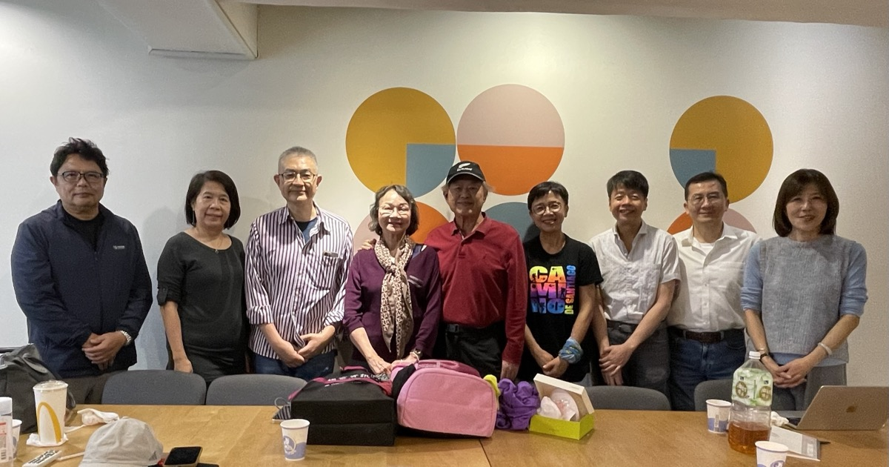

# 11.18 何不一起美好讀書會｜AI Agent 實作研習紀錄

> 2026年11月18日（週三）18:30–21:00「何不一起美好讀書會」活動紀錄。由益暉帶領同學們從本機 AI Agent 環境設定、資料夾位置確認到 GitHub 雲端同步，零程式基礎也能讓 AI 動手幫你做！

## 🌐 線上展示網址（GitHub Pages）

- **正式網址**：[https://agneschaorl-stack.github.io/book-club-1118/](https://agneschaorl-stack.github.io/book-club-1118/)
- **次級別名**：[https://agneschaorl-stack.github.io/book-club-1118/11.18何不一起美好讀書會.html](https://agneschaorl-stack.github.io/book-club-1118/11.18何不一起美好讀書會.html)

## 📱 LINE / Facebook 社群分享最佳化說明

本網站已完整配置符合 Open Graph (OG) 與 Twitter Cards 規範之社群分享標籤：
- **標準預覽封面圖**：1200 × 630 像素（符合 LINE / FB 1.91:1 標準比例，載入迅速且不裁切人物臉部）
- **社群卡片標題**：`11.18 何不一起美好讀書會｜AI Agent 實作研習紀錄`
- **社群卡片簡介**：`2026.11.18 讀書會實作紀錄：認真學習 AI Agent 方法，讓 AI 動手幫你做，現場實作紀實與全體合影。`

## 📖 內容章節與特色

1. **核心要點與工具評比**：零程式基礎、主流工具比較、個人素材網頁化、版本控制與雲端同步。
2. **五大核心實作地圖**：環境準備、資料夾定位、指令下達、版本保存、雲端發佈。
3. **現場實作紀實照片集**：9 幀現場高解析紀實照片，包含益暉操作教學、同學專注演練與課後全體溫馨合影。
4. **精緻互動功能**：
   - 支援「圖文模式 / 純圖模式」一鍵切換。
   - 燈箱式全螢幕點擊放大檢視與鍵盤巡覽（`←` / `→` / `Esc`）。
   - 內建 Parisian Chanson Waltz（巴黎香頌）鋼琴華爾滋背景音律。
